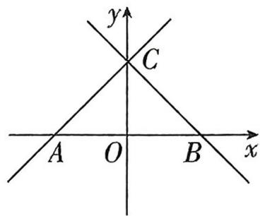

<!-- question-source:start -->
4[2025 广东广州质检, 中]如图, 直线 $y = x + 3$ 与两坐标轴分别交于点 $A, C$ , 直线 $BC$ 与直线 $AC$ 关于 $y$ 轴对称.

(1) 求点 $A, B, C$ 的坐标;

(2)若过点 O 的直线 l 将 $\triangle ABC$ 分成面积之比为 1:2 的两部分,求该直线的表达式.

<!-- question-source:end -->

![[Q00106020A1]]
