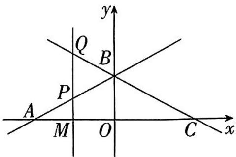
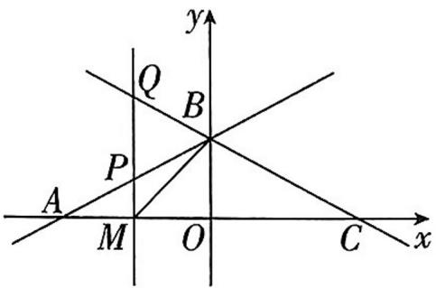

<!-- question-source:start -->
6[2025 江苏宿迁期末,较难]如图(1),函数 $y=\frac{1}{2}x+3$ 的图象与 x 轴交于点 A,与 y 轴交于点 B,点 C 与点 A 关于 y 轴对称.

(1)求直线 $BC$ 的函数表达式.

(2)设点 $M$ 是 $x$ 轴上的一个动点, 过点 $M$ 作 $y$ 轴的平行线, 交直线 $AB$ 于点 $P$ , 交直线 $BC$ 于点 $Q$ .

①若 $P Q$ 的长为 4 , 求点 $M$ 的坐标.

②如图(2), 连接 $BM$ , 在点 $M$ 的运动过程中是否存在点 $P$ , 使 $\angle BMP = \angle BAC$ , 若存在, 请求出点 $P$ 的坐标; 若不存在, 请说明理由.

图(1)

图(2)
<!-- question-source:end -->

![[Q00106022A1]]
