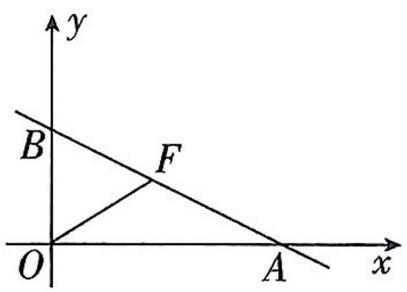
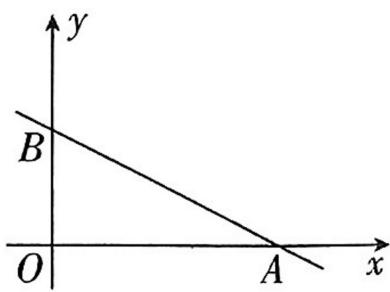

<!-- question-source:start -->
7 [2025 山西太原调研,较难] 如图,平面直角坐标系中,一次函数 $y = -\frac{1}{2}x + 5$ 的图象与 x 轴、y 轴分别交于点 A, B, 点 F 是线段 AB 上的一个动点(不与 A, B 重合),连接 OF, 设点 F 的横坐标为 x.

(1)直接写出 $A, B$ 两点的坐标；

(2)求 $\triangle OAF$ 的面积 $S$ 与 $x$ 之间的函数关系式, 并写出自变量 $x$ 的取值范围;

(3) 当 $\triangle OAF$ 的面积 $S = \frac{1}{2} S_{\triangle OAB}$ 时, 第一象限内存在点 $P$ , 使 $\triangle APF$ 是以 $AF$ 为直角边的等腰直角三角形, 直接写出点 $P$ 的坐标.

备用图

是个新“烤”鸭
电子错题本鸭
<!-- question-source:end -->

![[Q00106023A1]]
