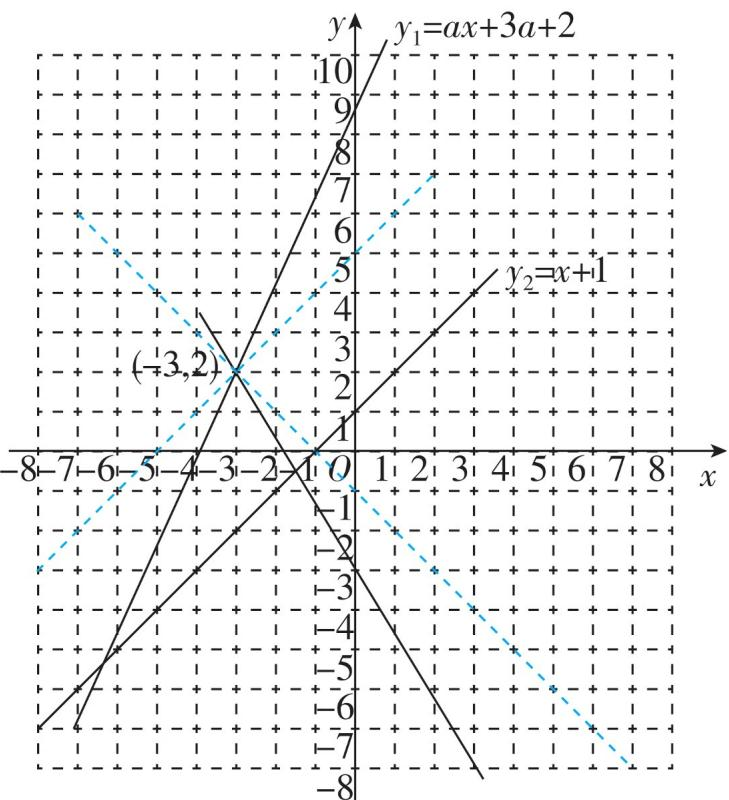

> [!success]- 必刷题
>
> > [!success] **【答案】** $(-3,2)$
>
> > [!note]- **【解析】**
> > 【解】(1)当 a = -1 时, $y_{1} = -x - 1$ . 令 $y_{1} = y_{2}$ , 得 -x - 1 = x + 1, 解得 x = -1. 当 x = -1 时, $y_{1} = -(-1) - 1 = 0$ , 所以当 a = -1 时, 两个函数图象的交点坐标为 $(-1, 0)$ .
> > (2) $y_{1}=ax+3a+2=a(x+3)+2$ . 由题意得 $x+3=0$ , 解得 x=-3, 此时, $y_{1}=2$ , 所以不论 a 为何值, $y_{1}=ax+3a+2$ (a 为常数, $a\neq0$ ) 的图象都经过定点 $(-3,2)$ , 故答案为 $(-3,2)$ .
> > (3)a<-1 或 a>1. 由(2)得 $y_{1}=ax+3a+2$ 的图象过定点 $(-3,2)$ . 画出函数图象如图所示:
> >
> > 
> >
> > 当直线 $y_{1}$ 过点 $(-1,0)$ 时， $-a+3a+2=0$ ，解得 a=-1。当直线 $y_{1}$ 与 $y_{2}$ 平行时，a=1。结合图象可知，若两个函数图象的交点在第三象限，则 a 的取值范围是 a<-1 或 a>1。
> >
> > 熟练掌握“将军饮马”模型是解题的关键.
