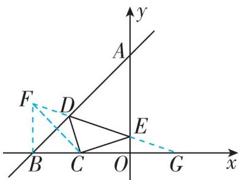

> [!success]- 必刷题
>
> > [!success] **【答案】** $2 \sqrt{10}$
>
> > [!note]- **【解析】**
> > 如图,作点 $C$ 关于 $AB$ 的对称点 $F$ ,关于 $AO$ 的对称点 $G$ ,连接 $DF,EG,FB,FC,FG$ . 因为直线 $y = x + 4$ 与两坐标轴分别交于 $A,B$ 两点,所以令 $x = 0$ ,则 $y = 4$ ,令 $y = 0$ ,则 $x = -4$ ,所以 $A(0,4),B(-4,0)$ ,所以 $OA = OB = 4$ . 又因为点 $C$ 是 $OB$ 的中点,所以 $OC = BC = \frac{1}{2} OB = 2$ . 因为点 $C$ 与点 $G$ 关于 $AO$ 对称,所以 $OG = OC = 2,EC = EG$ ,所以 $BG = OB + OG = 6$ . 因为 $OA = OB$ , $\angle AOB = 90^\circ$ , 所以 $\angle ABC = \angle BAO = 45^\circ$ . 又因为点 $C$ 与点 $F$ 关于 $AB$ 对称,所以 $\angle ABC = \angle ABF = 45^\circ$ , $BC = BF = 2,DF = DC$ , 所以 $\angle FBC = 90^\circ$ . 因为 $DF = DC$ , $EC = EG$ , 所以 $\triangle CDE$ 的周长为 $CD + DE + CE = DF + DE + EG \geqslant FG$ , 当点 $F,D,E,G$ 在同一直线上时, $\triangle CDE$ 的周长最小,为 $FG$ 的长. 因为在 Rt $\triangle BFG$ 中, $FG = \sqrt{BF^2 + BG^2} = 2 \sqrt{10}$ , 所以 $\triangle CDE$ 周长的最小值是 $2 \sqrt{10}$ . 故答案为 $2 \sqrt{10}$ .
> >
> > 
