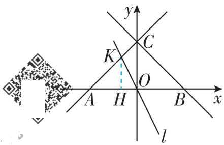
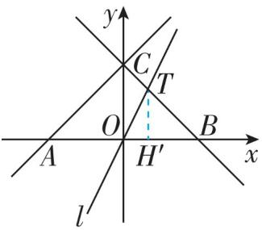

> [!success]- 必刷题
>
> > [!success] **【答案】** 详见解析
>
> > [!note]- **【解析】**
> > 【解】(1) 在 $y = x + 3$ 中, 令 $x = 0$ , 得 $y = 3$ , 令 $y = 0$ , 得 $x = -3$ , 所以 $A(-3,0), C(0,3)$ . 因为直线 $BC$ 与直线 $AC$ 关于 $y$ 轴对称, 所以点 $B$ 与点 $A$ 关于 $y$ 轴对称, 所以 $B$ 点坐标为 $(3,0)$ .
> >
> > 思路分析
> > (2) 分两种情况: ① 设直线 l 交 AC 于 K, 当 $S_{\triangle AOK}$ : $S_{四边形KOBC} = 1:2$ 时, 过 K 作 $KH \perp AB$ 于 H, 求得 K 点坐标, 即可求解;
> > - **②**：设直线 l 交 BC 于 T, 当 $S_{\triangle BOT}$ : $S_{四边形AOTC} = 1:2$ 时, 同理可解.
> >
> > (2)由(1)得 $A(-3,0), C(0,3), B(3,0)$ , 所以 $OA = OB = OC = 3, AB = 6$ , 所以 $S_{\triangle ABC} = \frac{1}{2} \times 6 \times 3 = 9$ . ①设直线 $l$ 交 $AC$ 于 $K$ , 当 $S_{\triangle AOK}: S_{\text{四边形}KOBC} = 1:2$ 时, 过 $K$ 作 $KH \perp AB$ 于 $H$ , 如图 (1), 所以 $S_{\triangle AOK} = \frac{1}{3} S_{\triangle ABC} = 3$ , 所以 $\frac{1}{2} OA \cdot HK = 3$ , 所以 $KH = 2$ . 对于 $y = x + 3$ , 令 $y = 2$ , 得 $x = -1$ , 所以 $K(-1,2)$ . 设直线 $l$ 的表达式为 $y = px (p \neq 0)$ , 将 $K(-1,2)$ 代入, 得 $2 = -p$ , 解得 $p = -2$ , 所以直线 $l$ 的表达式为 $y = -2x$ . ②设直线 $l$ 交 $BC$ 于 $T$ , 当 $S_{\triangle BOT}: S_{\text{四边形}AOTC} = 1:2$ 时, 过 $T$ 作 $TH' \perp AB$ 于 $H'$ , 如图 (2), 同理可得 $TH' = 2$ . 易得直线 $BC$ 的表达式为 $y = -x + 3$ . 对于 $y = -x + 3$ , 令 $y = 2$ , 得 $x = 1$ , 所以 $T(1,2)$ , 易得直线 $l$ 的表达式为 $y = 2x$ . 综上所述, 直线 $l$ 的表达式为 $y = -2x$ 或 $y = 2x$ .
> >
> > 
> > 图(1)
> >
> > 
> > 图(2)
