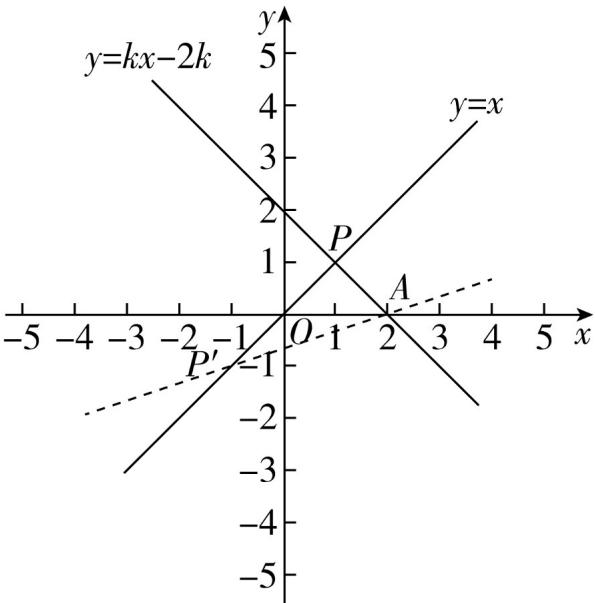

> [!success]- 必刷题
>
> > [!success] **【答案】** (2,0),(0,-2k)
>
> > [!note]- **【解析】**
> > 【解】(1)在 $y=kx-2k$ (k 为常数,且 $k\neq0$ )中,令y=0,得x=2;令x=0,得y=-2k,所以A(2,0),B(0,-2k).故答案为(2,0),(0,-2k).
> >
> > (2)线段MN的长度不发生变化.因为一次函数y=kx-2k的图象经过点(1,-2),所以-2=k-2k,所以k=2,所以一次函数表达式为y=2x-4.因为平行于x轴的两条直线 $l_{1},l_{2}$ 分别与一次函数y=2x-4的图象交于点M,N,点M,N的横坐标分别为m,n,且m-n=3,所以M(m,2m-4),N(n,2n-4),所以MN= $\sqrt{(m-n)^{2}+(2m-4-2n+4)^{2}}=\sqrt{5(m-n)^{2}}=\sqrt{5\times3^{2}}=3\sqrt{5}$ ,所以当m-n=3时,线段MN的长度不发生变化,为 $3\sqrt{5}$ .
> >
> > (3)如图,因为y=kx-2k=k(x-2),所以一次函数y=kx-2k的图象过定点A(2,0),所以OA=2.设一次函数y=kx-2k的图象与函数y=x图象的交点为P,点P的纵坐标为 $y_{P}$ .当 $S_{\triangle OAP}=1$ 时, $\frac{1}{2}OA\cdot|y_{P}|=1$ ,即 $\frac{1}{2}\times2|y_{P}|=1$ ,
> >
> > 解得 $y_{P}=1$ 或 $y_{P}=-1$ .因为点P在函数y=x的图象上,所以点P的坐标为(1,1)或(-1,-1).把(1,1)代入y=kx-2k,解得k=-1;把$(-1, - 1)$ 代入 $y = kx - 2k$ ，解得 $k = \frac{1}{3}$ 结合图象可知，若一次函数 $y = kx - 2k$ 的图象与函数 $y = x$ 的图象及 $x$ 轴所围成的三角形的面积不小于1，则 $k$ 的取值范围是 $k\leqslant -1$ 或 $k\geqslant \frac{1}{3}$ 且 $k\neq 1$
> >
> > 
> >
> > 关键点按
> > (3) 如图, 分 $\angle PAF = 90^{\circ}$ 和 $\angle P' FA = 90^{\circ}$ 两种情况讨论, 不要漏解.
> >
> > 思路分析
> > (2)②分点 M 在 y 轴左侧和右侧两种情况讨论, 由对称得出 $\angle BAC = \angle ACB$ , 进而得到 $\angle MBC = 90^{\circ}$ , 最后利用勾股定理建立方程求解即可.
