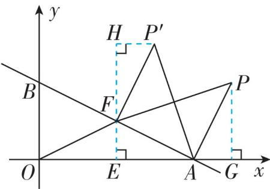

> [!success]- 必刷题
>
> > [!success] **【答案】** 详见解析
>
> > [!note]- **【解析】**
> > 【解】(1) $A(10,0)$ , $B(0,5)$ .
> > (2)由(1)可得 OA=10.
> > 因为点 F 是线段 AB 上的一个动点(不与 A, B 重合), 点 F 的横坐标为 x,
> > 所以 F 点坐标为 $\left(x, -\frac{1}{2}x + 5\right)$ ,
> > 所以 $S=\frac{1}{2}\times10\times\left(-\frac{1}{2}x+5\right)=-\frac{5}{2}x+25(0<x<10)$ ,
> > 即 $\triangle OAF$ 的面积S与x之间的函数关系式为 $S=-\frac{5}{2}x+25(0<x<10)$ .
> > (3) 点 P 的坐标为 $\left(\frac{25}{2},5\right)$ 或 $\left(\frac{15}{2},\frac{15}{2}\right)$ .
> > 如图, 过点 F 作 $FE \perp x$ 轴于点 E.
> >
> > 
> >
> > 由(1)可得 OB=5, 所以 $S_{\triangle OAB}=\frac{1}{2}\times5\times10=25$ .
> > 由(2)得 $S = -\frac{5}{2}x + 25$ .
> > 因为 $S = \frac{1}{2}S_{\triangle OAB}$ ，所以 $-\frac{5}{2}x + 25 = \frac{1}{2} \times 25$ ，解得 x = 5。将 x = 5 代入 $y = -\frac{1}{2}x + 5$ 中，得 $y = \frac{5}{2}$ ，
> > 所以 $F\left(5,\frac{5}{2}\right),E(5,0)$ .
> > 分两种情况：
> > - **①**：当 $\angle PAF = 90^{\circ}$ 时，AF = AP，过点 P 作 $PG \perp x$ 轴于 G，
> > 所以 $\angle FEA = \angle FAP = \angle PGA = 90^{\circ}$ ,
> > 所以 $\angle AFE + \angle FAE = \angle FAE + \angle PAG = 90^{\circ}$ ,
> > 所以 $\angle AFE = \angle PAG.$ 在 $\triangle FAE$ 和 $\triangle APG$ 中， $\left\{\begin{aligned}\angle FEA &= \angle AGP, \\ \angle AFE &= \angle PAG, \\ AF &= PA,\end{aligned}\right.$
> >
> > 所以 $\triangle FAE \cong \triangle APG$ (AAS), 所以 $FE = AG = \frac{5}{2}, AE = PG = OA - OE = 5$ , 所以 $OG = OA + AG = \frac{25}{2}$ , 所以 $P\left(\frac{25}{2}, 5\right)$ .
> > - **②**：当 $\angle P'FA = 90^\circ$ 时, $AF = AP'$ , 过点 $P'$ 作 $P'H \perp FE$ , 交 $EF$ 的延长线于点 $H$ , 同理可得 $\triangle P'HF \cong \triangle FEA$ (AAS), 所以 $FH = AE = 5$ , $HP' = FE = \frac{5}{2}$ , 所以易得 $P'\left(\frac{15}{2}, \frac{15}{2}\right)$ . 综上所述, 点 $P$ 的坐标为 $\left(\frac{25}{2}, 5\right)$ 或 $\left(\frac{15}{2}, \frac{15}{2}\right)$ .
> >
> > ## 全章综合训练
