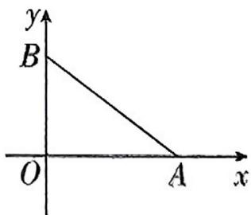

<!-- question-source:start -->
14[2025 黑龙江哈尔滨质检]如图, $A(m,0)$ , $B(0,n)$ , 且 $m,n$ 满足二元一次方程组 $\left\{ \begin{array}{l} m - n = 1, \\ 2m - 3n = -1. \end{array} \right.$ (1)求 $A,B$ 两点的坐标; (2)点 $P(t,0)$ 是线段 $OA$ 上一点, 连接 $BP$ , 当 $\triangle ABP$ 的面积为 $\frac{9}{2}$ 时, 求 $t$ 的值; (3)在(2)的条件下, 过点 $A$ 作直线 $l//y$ 轴, 在直线 $l$ 上有一点 $M$ , 直线 $BM$ 交 $x$ 轴正半轴于点 $K$ , 在射线 $BO$ 上是否存在一点 $N$ , 使 $\triangle BPN \cong \triangle PMK$ ? 若存在, 请求出点 $N$ 的坐标; 若不存在, 请说明理由.

<!-- question-source:end -->

![[Q00106163A1]]
