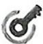

## 全章综合训练 刷中考

## 刷中考

## 考点1 二元一次方程

![[初中/课堂同步/教辅/必刷题/2026 八上必刷题 北师大数学/05_第五章_二元一次方程组/全章综合训练/questions/Q00106143.md]]
![[初中/课堂同步/教辅/必刷题/2026 八上必刷题 北师大数学/05_第五章_二元一次方程组/全章综合训练/questions/Q00106144.md]]

## 考点2 二元一次方程组

![[初中/课堂同步/教辅/必刷题/2026 八上必刷题 北师大数学/05_第五章_二元一次方程组/全章综合训练/questions/Q00106145.md]]
![[初中/课堂同步/教辅/必刷题/2026 八上必刷题 北师大数学/05_第五章_二元一次方程组/全章综合训练/questions/Q00106146.md]]

## 考点 3 二元一次方程组的实际应用

![[初中/课堂同步/教辅/必刷题/2026 八上必刷题 北师大数学/05_第五章_二元一次方程组/全章综合训练/questions/Q00106147.md]]
![[初中/课堂同步/教辅/必刷题/2026 八上必刷题 北师大数学/05_第五章_二元一次方程组/全章综合训练/questions/Q00106148.md]]

## 考点4 二元一次方程组与一次函数

![[初中/课堂同步/教辅/必刷题/2026 八上必刷题 北师大数学/05_第五章_二元一次方程组/全章综合训练/questions/Q00106149.md]]
