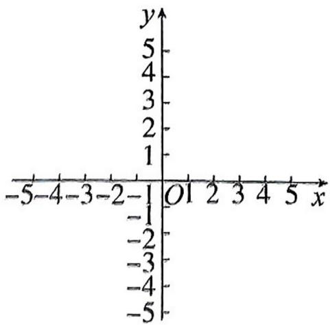

<!-- question-source:start -->
3 二元一次方程 $x - 2y = 0$ 的解有无数个, 其中一个解为 $\left\{ \begin{array}{l} x = 2, \\ y = 1, \end{array} \right.$ 所以在平面直角坐标系中就可以用点(2,1)表示它的一个解.

(1)请在下图中的平面直角坐标系中描出点(2,1),再描出三个以方程 $x - 2y = 0$ 的解为坐标的点.

(2)过(1)中的这四个点中的任意两点作直线, 你有什么发现? 直接写出结果.

(3)以方程 $x - 2y = 0$ 的解为坐标的点的全体叫作方程 $x - 2y = 0$ 的图象. 想一想, 方程 $x - 2y = 0$ 的图象是什么?

建议用时 20 分钟

答案 D56
<!-- question-source:end -->

![[Q00106116A1]]
