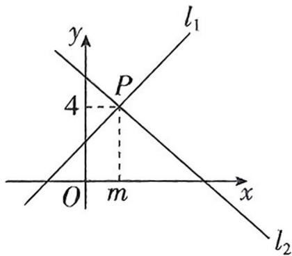

<!-- question-source:start -->
4 如图, 直线 $l_{1}: y = x + 2$ 与直线 $l_{2}: y = kx + b$ 相交于点 P, 则方程组 $\left\{\begin{aligned}y &= x + 2, \\ y &= kx + b\end{aligned}\right.$ 的解是（）

A. $\left\{ \begin{array}{l}x = 2,\\ y = 0 \end{array} \right.$ B. $\left\{ \begin{array}{l}x = 1,\\ y = 4 \end{array} \right.$ C. $\left\{ \begin{array}{l}x = 4,\\ y = 2 \end{array} \right.$ D. $\left\{ \begin{array}{l}x = 2,\\ y = 4 \end{array} \right.$
<!-- question-source:end -->

![[Q00106117A1]]
