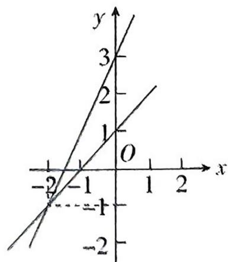

<!-- question-source:start -->
7[2025 山东泰安期中]方程
组 $\left\{\begin{aligned}ax+y&=3,\\ x+by&=-1\end{aligned}\right.$ 所对应的一次
函数的图象如图所示,则 $2a+b$ 的值为 ( )
A.-5 B.3
C.5 D.-3

<!-- question-source:end -->

![[Q00106120A1]]
