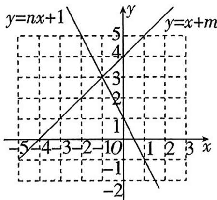

<!-- question-source:start -->
4[2024 贵州遵义调研, 较难]如图, 在平面直角坐标系中, 一次函数 $y = x + m$ 的图象和一次函数 $y = nx + 1$ 的图象分别与 $y$ 轴交于点(0,

4), (0,1), 则关于 $x, y$ 的二元一次方程组 $\left\{ \begin{array}{l} y = x + m - 3, \\ y = nx + 1 \end{array} \right.$ 的解为 \_\_\_\_.
<!-- question-source:end -->

![[Q00106123A1]]
