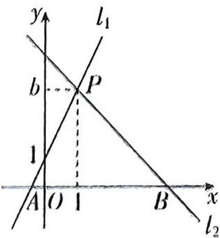

<!-- question-source:start -->
5[中]如图, 直线 $l_{1}: y = 2x + 1$ 与直线 $l_{2}: y = mx + 4$ 相交于点 $P(1, b)$ , 直线 $l_{1}, l_{2}$ 与 $x$ 轴分别交于 $A, B$ 两点.

(1) 求 $b, m$ 的值, 并结合图象写出关于 $x, y$ 的方程组 $\left\{ \begin{array}{l} 2x - y = -1, \\ mx - y = -4 \end{array} \right.$ 的解;

(2) 求 $\triangle ABP$ 的面积;

(3) 垂直于 $x$ 轴的直线 $x = a$ 与直线 $l_{1}, l_{2}$ 分别交于点 $C, D$ , 若线段 $CD$ 的长为 2, 求 $a$ 的值.

<!-- question-source:end -->

![[Q00106124A1]]
