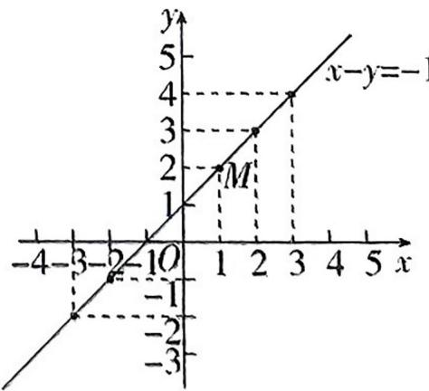

<!-- question-source:start -->
6 思想方法 数形结合 [2024 山东青岛期中,较难] 我们知道,二元一次方程有无数个解. 在平面直角坐标系中,我们标出以某个二元一次方程的解为坐标的点,就会发现这些点在同一条直线上.
例如: $\begin{cases}x=1,\\y=2\end{cases}$ 是方程x-y=-1的一个解,对应点为M(1,2).如图所示,我们在平面直角坐标系中将其标出,该方程的其他解还对应点(2,3),(3,4)……将这些点连起来,可以发现它们在同一条直线上,反过来,在这条直线上任取一点,这个点的坐标也是方程x-y=-1的解,所以我们把这条直线叫作方程x-y=-1的图象.
一般地,以二元一次方程的解为坐标的点连成的直线就叫这个方程的图象.请解答下列问题:
(1)已知A(1,1),B(-3,4),C $\left(\frac{1}{2},2\right)$ ,则点\_\_\_\_(填“A”或“B”或“C”)在方程2x-y=-1的图象上.
(2)求方程2x+3y=9和方程3x-4y=5图象的交点坐标.
(3)已知以关于x,y的方程组 $\left\{\begin{aligned}&5x+3y=20+7m,\\ &3x+4y=19-14m\end{aligned}\right.$ 的解为坐标的点在方程 $x+y=5$ 的图象上,当t>m时,化简 $\sqrt{(-t-2)^{2}}-|1-7t|$ .

<!-- question-source:end -->

![[Q00106125A1]]
