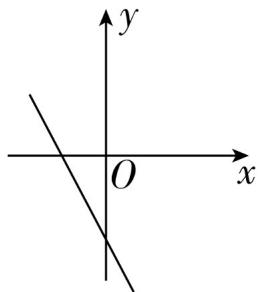

> [!success]- 必刷题
>
> > [!success] **【答案】** $\left\{\begin{aligned} x &= 2, \\ y &= 3
>
> > [!note]- **【解析】**
> > 
> > 【解析】因为点(2,3)在一次函数 y=2x-1 的图象上, 所以 $\left\{\begin{aligned} x &= 2, \\ y &= 3 \end{aligned}\right.$ 为方程 y=2x-1 的一个解, 即方程 2x-y=1 的一个解为 $\left\{\begin{aligned} x &= 2, \\ y &= 3. \end{aligned}\right.$ 故答案为 $\left\{\begin{aligned} x &= 2, \\ y &= 3. \end{aligned}\right.$
