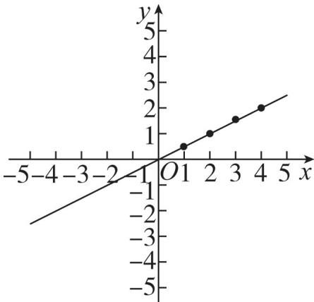

> [!success]- 必刷题
>
> > [!success] **【答案】** 详见解析
>
> > [!note]- **【解析】**
> > 【解】(1)(答案不唯一)因为二元一次方程 $x-$
> >
> > 一个二元一次方程的所有解在平面直角坐标系中对应的点构成了一条直线,这条直线就是这个二元一次方程整理成一次函数形式后对应的函数图象.
> >
> > 刷有所得二元一次方程组的解就是使方程组中的两个方程同时成立的一对未知数的值,而这一对未知数的值也同时满足两个相应的一次函数表达式,因此二元一次方程组的解就是两个相应的一次函数图象的交点的横、纵坐标.
> >
> > ## 刷有所得
> >
> > 2y=0 的解可以为 $\left\{\begin{aligned}x&=1,\\ y&=\frac{1}{2},\end{aligned}\right.\left\{\begin{aligned}x&=3,\\ y&=\frac{3}{2},\end{aligned}\right.\left\{\begin{aligned}x&=4,\\ y&=2,\end{aligned}\right.$ 所以以方程 x-2y=0 的解为坐标的点可以是 $\left(1,\frac{1}{2}\right),\left(3,\frac{3}{2}\right),(4,2)$ . 它们在平面直角坐标系中的位置如图所示.
> >
> > (2)如图, 可知四个点在一条直线上.
> >
> > 
> >
> > (3)由原方程,得 $y=\frac{x}{2}$ . 因为以方程 x-2y=0 的解为坐标的点的全体叫作方程 x-2y=0 的图象,所以方程 x-2y=0 的图象就是正比例函数 $y=\frac{x}{2}$ 的图象. 因为正比例函数 $y=\frac{x}{2}$ 的图象是经过第一、三象限且过原点的一条直线,所以方程 x-2y=0 的图象是经过第一、三象限且过原点的一条直线.
