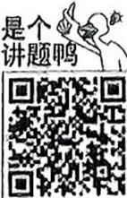

<!-- question-source:start -->
7[中]两位同学在解方程组时,甲同学由 $\left\{\begin{aligned}ax+by=2,\\cx-y=-4\end{aligned}\right.$ 正确地解出 $\left\{\begin{aligned}x=3,\\y=-2,\end{aligned}\right.$ 乙
同学因把c写错了解得 $\left\{\begin{aligned}x=-2,\\y=2,\end{aligned}\right.$ 则 $a+b+c$ 的值为
( )
A.3 B.0 C.1 D.7

<!-- question-source:end -->

![[Q00106067A1]]
