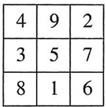
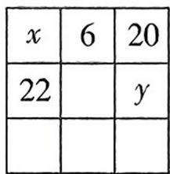

<!-- question-source:start -->
2[2025 河北唐山期中, 中]我国古代数学名著《增删算法统宗》中有一个“隔沟计算”的问题: “甲乙隔沟牧放, 二人暗里参详. 甲云得乙九只羊, 多乙一倍之上. 乙说得甲九只, 两家之数相当. 二人闲坐恼心肠, 画地算了半晌.” 其大意为甲、乙两人一起放牧, 两人心里暗中数羊. 如果乙给甲 9 只羊, 那么甲的羊数比乙的羊数多 1 倍; 如果甲给乙 9 只羊, 那么两人的羊数相同, 二人闲坐动脑筋, 在地上算了很长时间. 请问甲、乙各有多少只羊? 设甲有 x 只羊, 乙有 y 只羊, 则下列说法正确的是 ( )

A. 列方程为 $x+9=2(x-18+9)$ B. 列方程组为 $\left\{\begin{aligned}x-9&=2(y+9),\\ x+9&=y-9\end{aligned}\right.$ C. 列方程组为 $\left\{\begin{aligned}x+9&=2(y-9),\\ x-9&=y+9\end{aligned}\right.$ D. 甲有 27 只羊, 乙有 18 只羊

[2025 山西吕梁期末, 中]我国古代数学著作《九章算术》中有这样一题, 原文是“今有大器五、小器一容三斛, 大器一、小器五容二斛, 问大、小器各容几何?”意思是有大、小两种盛酒的桶, 已知 5 个大桶加上 1 个小桶可以盛酒 3 斛 (斛是古代的一种容量单位), 1 个大桶加上 5 个小桶可以盛酒 2 斛, 则 6 个大桶加上 6 个小桶可以盛酒 \_\_\_\_ 斛.

[2025 湖南常德期中, 中]幻方是古老的数学问题, 我国古代的《洛书》中记载了最早的幻

建议用时 20 分钟 答案 D54

方——九宫格. 将 9 个数填入幻方的空格中, 要求每一横行、每一竖列以及两条对角线上的 3 个数之和相等, 例如, 图(1)就是一个幻方, 图(2)是一个未完成的幻方, 则 $x$ 与 $y$ 的积是 \_\_\_\_.

图(1)
图(2)
<!-- question-source:end -->

![[Q00106102A1]]
