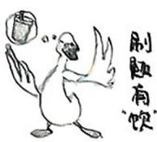

<!-- question-source:start -->
10 解方程组: $\left\{ \begin{array}{l} \frac{x - 1}{2} - \frac{y}{3} = 1, \\ y + 3x = 5. \end{array} \right.$ ①
下面是马虎的解答,你认为他的解法正确吗?
若不正确,请给出正确解法.
解:方程①去分母,得 $3(x - 1) - 2y = 1$ ,即 $3x - 2y = 4$ . ③
②-③,得 $3y = 1$ ,解得 $y = \frac{1}{3}$ .
把 $y = \frac{1}{3}$ 代入②,得 $\frac{1}{3} + 3x = 5$ ,解得 $x = \frac{14}{9}$ .
所以原方程组的解为 $\left\{ \begin{array}{l} x = \frac{14}{9}, \\ y = \frac{1}{3}. \end{array} \right.$

<!-- question-source:end -->

![[Q00106081A1]]
