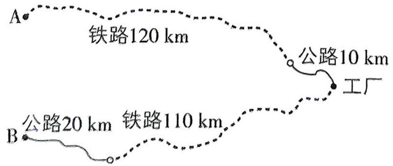

<!-- question-source:start -->
2[2025 甘肃陇南期末, 中]如图, 某工厂与 A、B 两地有公路、铁路相连, 这家工厂从 A 地购买一批每吨 1 000 元的原料经铁路 120 km 和公路 10 km 运回工厂, 制成每吨 8 000 元的产品, 再经铁路 110 km 和公路 20 km 销售到 B 地. 已知铁路的运费为 1.2 元/(t·km), 公路的运费为 1.5 元/(t·km), 且这两次运输共支出铁路运费 124 800 元, 公路运费 19 500 元.

(1) 设原料质量为 $x t$ , 产品质量为 $y t$ , 根据题中数量关系填写下表:

建议用时 20 分钟 答案 D55

合计(元)
124 800
<!-- question-source:end -->

![[Q00106105A1]]
