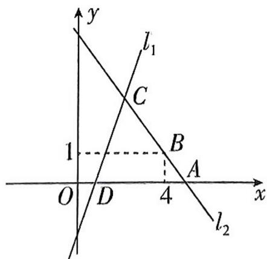

<!-- question-source:start -->
4 如图, 直线 $l_{1}$ 的表达式为 $y = 3x - 2$ , 且直线 $l_{1}$ 与 $x$ 轴交于点 $D$ . 直线 $l_{2}$ 与 $x$ 轴交于点 $A$ , 且经过点 $B$ , 直线 $l_{1}$ 与 $l_{2}$ 交于点 $C(m,3)$ .

(1) 求点 $D$ 和点 $C$ 的坐标;

(2)求直线 $l_{2}$ 的表达式；

(3)利用函数图象写出关于 $x, y$ 的二元一次方程组 $\left\{ \begin{array}{l} y = 3x - 2, \\ 6x + 7y = 31 \end{array} \right.$ 的解.

建议用时 20 分钟 答案 D57
<!-- question-source:end -->

![[Q00106128A1]]
