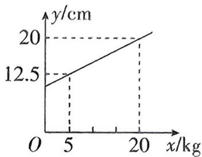

<!-- question-source:start -->
5 在弹性限度内, 弹簧的长度 $y(\text{cm})$ 与所挂物体的质量 $x(\text{kg})$ 之间是一次函数关系, 图象如图所示, 则弹簧不挂物体时的

长度是 ( ) A. $9 \mathrm{~cm}$ B. $10 \mathrm{~cm}$ C. $10.5 \mathrm{~cm}$ D. $11 \mathrm{~cm}$
<!-- question-source:end -->

![[Q00106129A1]]
