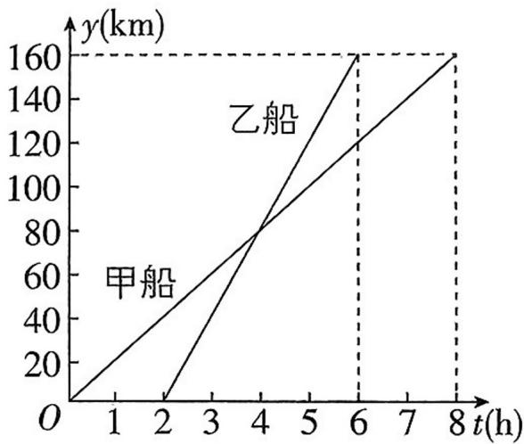
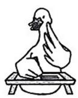

<!-- question-source:start -->
6[2025 湖北武汉质检]如图表示的是甲、乙两船沿相同路线从 A 港出发到 B 港的行驶过程中, 路程 $y(\mathrm{km})$ 随时间 $t(\mathrm{h})$ 变化的图象, 则乙船出发多长时间赶上甲船 ( )

这题鸦不会但不能空着

A. $1.5 \mathrm{~h}$ B. $2 \mathrm{~h}$ C. $2.5 \mathrm{~h}$ D. $3.5 \mathrm{~h}$
<!-- question-source:end -->

![[Q00106130A1]]
