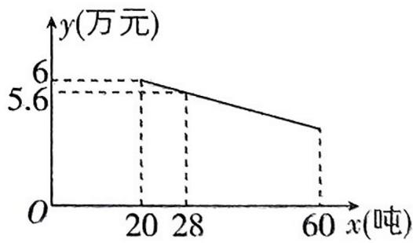

<!-- question-source:start -->
7[2024 江西九江期末]某工厂生产一种产品, 当生产数量至少为 20 吨, 但不超过 60 吨时, 每吨的成本 $y$ (万元)与生产数量 $x$ (吨)之间是一次函数关系, 其图象如图所示.

(1)求出 $y$ 关于 $x$ 的函数表达式;

(2)如果每吨的成本是4.8万元,求该产品的生产数量.

<!-- question-source:end -->

![[Q00106131A1]]
