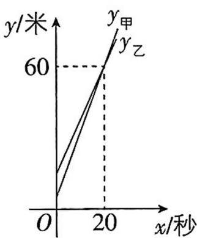

<!-- question-source:start -->
3[2025 福建厦门期末, 中]某校科技节上, 同学们在操场进行无人机表演, 其中甲、乙两架无人机离操场地面的高度 $y$ (单位: 米) 与表演时间 $x$ (单位: 秒) 的图象如图所示. 已知

表演开始时甲、乙离地的高度分别是 5 米、15 米, 在 1 分钟的表演过程中甲、乙两架无人机的高度差不超过 5 米的时间可持续\_\_\_\_秒.
<!-- question-source:end -->

![[Q00106133A1]]
