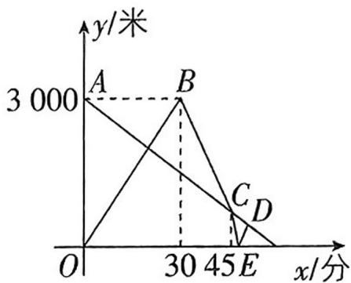

<!-- question-source:start -->
5[中]小明从家去体育场锻炼,同时,妈妈从体育场以50米/分的速度回家,小明到体育场后发现要下雨,立即返回,追上妈妈后,小明以250米/分的速度回家取伞,立即又以250米/分的速度折回接妈妈,两人一同回家. 如图是两人离家的距离 y(米)与小明出发的时间 x(分)之间的函数图象.

(注:小明和妈妈始终在同一条笔直的公路上行走,图象上A,C,D三点在一条直线上)

(1) 求线段 $BC$ 的函数表达式;

(2)求点 $D$ 的坐标,并说明点 $D$ 的实际意义.

<!-- question-source:end -->

![[Q00106135A1]]
