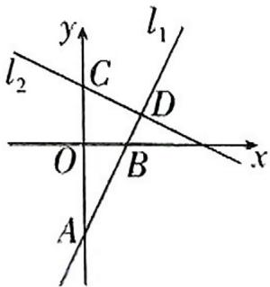

<!-- question-source:start -->
6[2024 山东淄博期末,较难]如图,直线 $l_{1}:y_{1}=kx+b$ 与 y 轴交于点 A,与 x 轴交于点 $B\left(\frac{3}{2},0\right)$ ,
直线 $l_{2}:y_{2}=-\frac{1}{2}x+2$ 与 y 轴交于点 C,与直线 $l_{1}$ 交于点 D, 点 D 到 y 轴的距离为 2.
(1) 求直线 $l_{1}$ 的函数表达式.

(2) 请直接写出方程组 $\left\{ \begin{array}{l} kx - y = -b, \\ x + 2y = 4 \end{array} \right.$ 的解: \_\_\_\_.

(3)求 $\triangle ACD$ 的面积.

(4)在直线 $l_{1}$ 上是否存在异于点 $D$ 的另一点 $M$ , 使得 $\triangle ACD$ 与 $\triangle ACM$ 的面积相等? 若存在, 请求出点 $M$ 的坐标; 若不存在, 请说明理由.

电子错题本鸭
<!-- question-source:end -->

![[Q00106136A1]]
