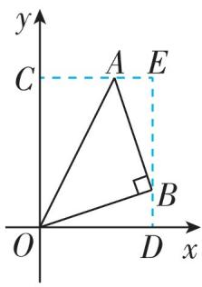

> [!success]- 必刷题
>
> > [!success] **【答案】** $y = -3x + 10$
>
> > [!note]- **【解析】**
> > 如图, 过点 $A$ 作 $AC \parallel x$ 轴交 $y$ 轴于点 $C$ , 过点 $B$ 作 $BD \parallel y$ 轴交 $x$ 轴于点 $D$ , 两条直线相交于点 $E$ , 易得 $\angle ACO = \angle E = \angle BDO = 90^\circ$ , 所以 $\angle BAE + \angle EBA = 90^\circ$ . 因为 $\angle ABO = 90^\circ$ , 所以 $\angle EBA + \angle OBD = 90^\circ$ , 所以 $\angle OBD = \angle BAE$ . 因为 $B(3,1)$ , 所以 $OD = 3, BD = 1$ . 在 $\triangle ABE$ 与 $\triangle BOD$ 中, $\begin{cases} \angle AEB = \angle ODB = 90^\circ, \\ \angle BAE = \angle OBD, \\ AB = OB, \end{cases}$ 所以 $\triangle ABE \cong \triangle BOD(AAS)$ , 所以 $AE = BD = 1, BE = OD = 3$ , 所以 $AC = CE - AE = OD - AE = 2, DE = BD + BE = 4$ , 所以 $A(2,4)$ . 设直线 $AB$ 的表达式为 $y = kx + b$ . 将 $A(2,4), B(3,1)$ 代入, 得 $\begin{cases} 2k + b = 4, \\ 3k + b = 1, \end{cases}$ 解得 $\begin{cases} k = -3, \\ b = 10, \end{cases}$ 所以直线 $AB$ 的表达式为 $y = -3x + 10$ . 故答案为 $y = -3x + 10$ .
> >
> > 
