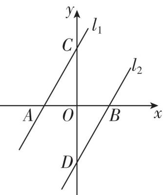

> [!success]- 必刷题
>
> > [!success] **【答案】** A
>
> > [!note]- **【解析】**
> > 根据题意,画出示意图如图. 设直线 $l_{1}$ 与 $y$ 轴交于点 $C$ , 点 $C$ 的坐标为 $(0, n) (n > 0)$ , 直线 $l_{2}$ 与 $y$ 轴交于点 $D$ . 因为点 $A$ 与点 $B$ 关于 $y$ 轴对称, 所以点 $B$ 的坐标为
> >
> > 
> >
> > (2,0). 因为直线 $l_{1}$ 与两坐标轴围成的三角形的面积为 4, 点 $A(-2,0)$ , 所以 $\frac{1}{2} \times |-2| \times n = 4$ , 解得 $n = 4$ , 所以点 $C$ 的坐标为 $(0,4)$ . 设直线 $l_{1}$ 的表达式为 $y = kx + b$ . 把 $A(-2,0), C(0,4)$ 代入, 得 $\left\{ \begin{array}{l} -2k + b = 0, \\ b = 4, \end{array} \right.$ 解得 $\left\{ \begin{array}{l} k = 2, \\ b = 4, \end{array} \right.$ 所以 $y = 2x + 4$ . 因为直线 $l_{2}$ 由直线 $l_{1}$ 平移得到, 所以设直线 $l_{2}$ 的表达式为 $y = 2x + b'$ . 把 $B(2,0)$ 代入, 得 $2 \times 2 + b' = 0$ , 解得 $b' = -4$ , 所以直线 $l_{2}$ 的表达式为 $y = 2x - 4$ , 所以点 $D$ 的坐标为 $(0,-4)$ , 所以 $m = 4 - (-4) = 8$ . 故选 A.
> >
> > 3.20 【解析】设 $y_{甲}=k_{1}x+b_{1}$ ，将(0,5)，(20,60)
> >
> > 分别代入，得 $\left\{\begin{aligned}5&=b_{1},\\ 60&=20k_{1}+b_{1}\end{aligned}\right.$ 解得 $\left\{\begin{aligned}k_{1}&=2.75,\\ b_{1}&=5,\end{aligned}\right.$ 则 $y_{甲}=2.75x+5$ 。设 $y_{乙}=k_{2}x+b_{2}$ ，将(0,15)，(20,60) 分别代入，得 $\left\{\begin{aligned}15&=b_{2},\\ 60&=20k_{2}+b_{2}\end{aligned}\right.$ 解得 $\left\{\begin{aligned}k_{2}&=2.25,\\ b_{2}&=15,\end{aligned}\right.$ 则 $y_{乙}=2.25x+15$ 。当 x<20 时， $y_{乙}-y_{甲}=5$ ，即 $2.25x+15-2.75x-5=5$ ，解得 x=10；当 x>20 时， $y_{乙}-y_{甲}=-5$ ，即 $2.25x+15-2.75x-5=-5$ ，解得 x=30。30-10=20（秒）。故答案为 20。
