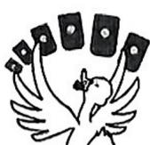

<!-- question-source:start -->
4[2025 湖北黄冈质检, 中]已知关于 $x, y$ 的方程组 $\left\{ \begin{array}{l} 2x + 3y = 7, \\ mx + ny = 5 \end{array} \right.$ 和方程组 $\left\{ \begin{array}{l} 5x - 2y = 8, \\ \frac{nx}{3} + my = 3 \end{array} \right.$ 的解相同.

(1) 求 $m, n$ 的值.

(2)求 $3m - 2mn + m^2 -1$ 的值.

刷发财了鸭

建议用时 25 分钟 答案 D53
<!-- question-source:end -->

![[Q00106097A1]]
