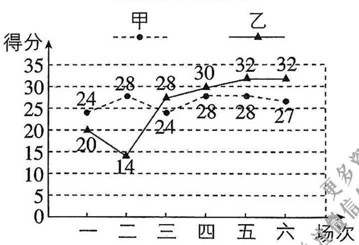

<!-- question-source:start -->
7 [2024 河南中考]为提升学生体质健康水平,促进学生全面发展,学校开展了丰富多彩的课外体育活动. 在八年级组织的篮球联赛中,甲、乙两名队员表现优异,他们在近六场比赛中关于得分、篮板和失误三个方面的统计结果如下.

比赛得分统计图

技术统计表

<table><tr><td>队员</td><td>平均每场得分</td><td>平均每场篮板</td><td>平均每场失误</td></tr><tr><td>甲</td><td>26.5</td><td>8</td><td>2</td></tr><tr><td>乙</td><td>26</td><td>10</td><td>3</td></tr></table>

根据以上信息,回答下列问题.

(1) 这六场比赛中, 得分更稳定的队员是\_\_\_\_(填“甲”或“乙”); 甲队员得分的中位数为 27.5 分, 乙队员得分的中位数为 \_\_\_\_ 分.

(2)请从得分方面分析:这六场比赛中,甲、乙两名队员谁的表现更好.

(3)规定“综合得分”为平均每场得分×1+平均每场篮板×1.5+平均每场失误×(-1)，且综合得分越高表现越好。请利用这种评价方法，比较这六场比赛中甲、乙两名队员谁的表现更好。
<!-- question-source:end -->

![[Q00106231A1]]
