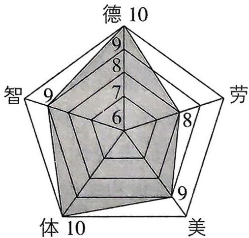

<!-- question-source:start -->
2[2025 安徽宿州期末]某校奉行五育并举,德智体美劳全面发展的原则,期末成绩按 3:2:2:1:2 的比例从德、智、体、美、劳五方面评分,

确定最终成绩. 小明本学期这五方面的成绩情况如图所示(单位: 分. 每项满分为 10 分), 则小明期末最终成绩为 ( )
A.9.1 分 B.9.2 分 C.9.3 分 D.9.4 分
<!-- question-source:end -->

![[Q00106232A1]]
