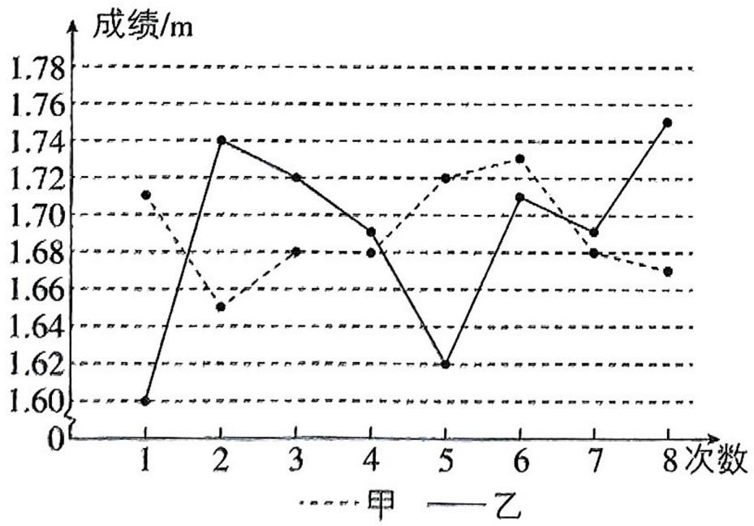

<!-- question-source:start -->
11[2025 广东深圳质检]某校拟派一名跳高运动员参加一项比赛,对甲、乙两名跳高运动员进行了8次选拔比赛,他们的成绩(单位:m)如下:甲:1.71,1.65,1.68,1.68,1.72,1.73,1.68,1.67;乙:1.60,1.74,1.72,1.69,1.62,1.71,1.69,1.75.

【整理与分析】

<table><tr><td></td><td>平均数</td><td>众数</td><td>中位数</td></tr><tr><td>甲</td><td>1.69</td><td>a</td><td>1.68</td></tr><tr><td>乙</td><td>1.69</td><td>1.69</td><td>b</td></tr></table>

(1) 填空: $a = \_\_\_\_ , b = \_\_\_\_ .$

(2)这两人中，\_\_\_\_的成绩更为稳定。(填“甲”或“乙”)
<!-- question-source:end -->

![[Q00106241A1]]
