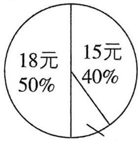

<!-- question-source:start -->
1. [2024 江苏南京期中]学校食堂有 15 元、18 元、20 元三种盒饭供学生选择(每人购一份).某天盒饭销售情况如图所示,则当天学生购买盒饭费用的平均数是（）

学校食堂某天盒饭销售情况统计图

A. 15 元
B. 16 元
C. 17 元
D. 18 元
<!-- question-source:end -->

![[Q00106411A1]]
