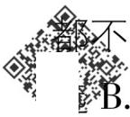

> [!success]- 必刷题
>
> > [!success] **【答案】** B
>
> > [!note]- **【解析】**
> > 当 78 少记了 5 时, 应是 83, 中位数和众数都不发生改变; 当 85 少记了 5 时, 应是 90, 中位数和众数都发生改变; 当 90 少记了 5 时, 应是 95, 中位数和众数都不发生改变; 当 93 少记了 5 时, 应是 98, 中位数和众数都不发生改变, 所以记错的数据是 85. 故 B.
> >
> > 
> >
> > B 【解析】① $1 \div 0.05 = 20$ , 故表中 $m$ 的值为 20, 是合理推断;
> > - **②**：$20 \times 0.2 = 4, 20 \times 0.3 = 6, 1 + 2 + 6 + 3 = 12$ , 故表中 $b$ 的值最小为 8, 是不合理推断;
> > - **③**：$1 + 2 + 4 = 7, 1 + 2 + 6 = 9$ , 故这 $m$ 天的日均可回收物回收量的中位数在 $4 \leqslant x < 5$ 组, 是合理推断;
> > - **④**：由①知 $m = 20$ , 由②知 $b$ 的值最小为 8, 此时 $3 \leqslant x < 4$ 组的频数为 $6, 3 \leqslant x < 4$ 组的频率 $a$ 取 0.30, 则平均数为 $(1.5 \times 1 + 2.5 \times 2 + 3.5 \times 6 + 4.5 \times 8 + 5.5 \times 3) \div 20 = 4$ , 即平均数最小为 4, 是不合理推断. 故所有合理推断的序号为①③.
> >
> > 6.2 【解析】数据 1,1,3,4,5,5,6,7,共有 8 个数,故 $25\%$ 分位数是 $\frac{1+3}{2}=2$ .
> >
> > 7.7.5 【解析】由题意知,该款手机的综合成绩为 $7 \times \frac{3}{3 + 3 + 2 + 2} + 8 \times \frac{3}{3 + 3 + 2 + 2} + 9 \times \frac{2}{3 + 3 + 2 + 2} + 6 \times \frac{2}{3 + 3 + 2 + 2} = 7.5$ (分). 故答案为 7.5.
> >
> > 8.9 【解析】求 20 个数据的平均数时, 错将其中一个数据 201 输入为 21, 即少加了 201 - 21 = 180, 由此求出的这组数据的平均数比实际平均数少 $\frac{180}{20} = 9$ , 故答案为 9.
