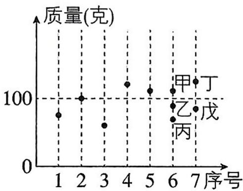

<!-- question-source:start -->
3[2025 浙江温州质检]某公司拟推出由7个盲盒组成的套装产品,现有10个盲盒可供选择,统计这10个盲盒的质量

如图所示. 序号为 1 到 5 的盲盒已选定, 这 5 个盲盒质量的中位数恰好为 100 克, 6 号盲盒从甲、乙、丙中选择 1 个, 7 号盲盒从丁、戊中选择 1 个, 使选定的 7 个盲盒质量的中位数大于 100 克, 可以选择 ( )
A. 甲、丁 B. 乙、戊 C. 丙、丁 D. 丙、戊
<!-- question-source:end -->

![[Q00106209A1]]
