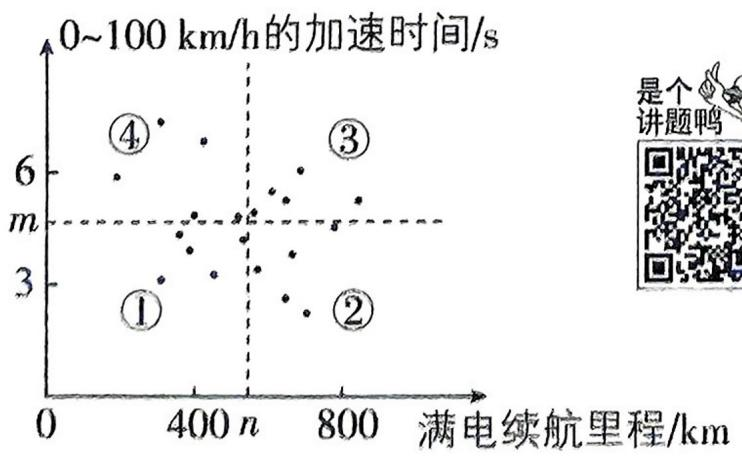

<!-- question-source:start -->
3[中]某汽车评测机构对市面上多款新能源汽车的0\~100 km/h的加速时间和满电续航里程进行了性能评测,评测结果绘制如下,每个点都对应一款新能源汽车的评测数据.已知0\~100 km/h的加速时间的中位数是m s,满电续航里程的中位数是n km,相应的直线将平面分成了①②③④四个区域(直线不属于任何区域).欲将最新上市的两款新能源汽车的评测数据对应的点绘制到平面内,若以上两组数据的中位数均保持不变,则这两个点可能分别落在()

A. 区域①② B. 区域①③ C. 区域①④ D. 区域③④
<!-- question-source:end -->

![[Q00106215A1]]
