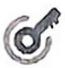

## 课时 1 中位数 刷基础

课时 1 中位数

电子错题本鸭

## 刷基础

## 知识点 1 中位数

![[初中/课堂同步/教辅/必刷题/2026 八上必刷题 北师大数学/06_第六章_数据的分析/课时_1_中位数/questions/Q00106207.md]]
![[初中/课堂同步/教辅/必刷题/2026 八上必刷题 北师大数学/06_第六章_数据的分析/课时_1_中位数/questions/Q00106208.md]]
![[初中/课堂同步/教辅/必刷题/2026 八上必刷题 北师大数学/06_第六章_数据的分析/课时_1_中位数/questions/Q00106209.md]]

## 知识点 2 众数、平均数、方差与中位数的综合

![[初中/课堂同步/教辅/必刷题/2026 八上必刷题 北师大数学/06_第六章_数据的分析/课时_1_中位数/questions/Q00106405.md]]
![[初中/课堂同步/教辅/必刷题/2026 八上必刷题 北师大数学/06_第六章_数据的分析/课时_1_中位数/questions/Q00106210.md]]
![[初中/课堂同步/教辅/必刷题/2026 八上必刷题 北师大数学/06_第六章_数据的分析/课时_1_中位数/questions/Q00106211.md]]
![[初中/课堂同步/教辅/必刷题/2026 八上必刷题 北师大数学/06_第六章_数据的分析/课时_1_中位数/questions/Q00106212.md]]

## 易错点 在求中位数时忽略排序而致错

![[初中/课堂同步/教辅/必刷题/2026 八上必刷题 北师大数学/06_第六章_数据的分析/课时_1_中位数/questions/Q00106213.md]]
