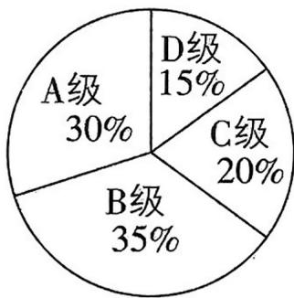

<!-- question-source:start -->
3[2025 陕西汉中期末]某班举行课后延时手工制作比赛,除参赛选手外,其他同学作为评委,分别给每一位参赛选手的作品进行打分,成绩分为 A,

B,C,D 四个等级,其中相应等级的得分依次记为 10 分,8 分,6 分,4 分,评委将参赛选手的成绩整理并绘制成如图所示的扇形统计图,由图可知, 参赛选手成绩的众数为\_\_\_\_分.
<!-- question-source:end -->

![[Q00106166A1]]
