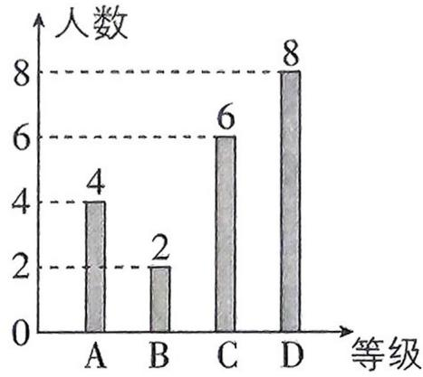

<!-- question-source:start -->
7 [2025 河北沧州期中, 中]某校进行消防安全知识测试, 测试成绩只分为 A, B, C, D 四个等级, 等级得分依次记为 10 分, 9 分, 8 分, 7 分. 学校随机抽取了 20 名学生的成绩进行整理, 得到了如图所示信息.

(1) 求此次测试中被抽取的学生成绩的众数和平均数;

(2)为了使平均数更准确一些,又抽取了10名学生的成绩,其中得9分的有6名,得8分的有2名,还有两名学生M和N的成绩被墨水污染(都不是8分和9分),且学生M的成绩高于学生N的成绩.求M和N两名学生的成绩,并与(1)相比,判断众数是否发生变化.

<!-- question-source:end -->

![[Q00106181A1]]
