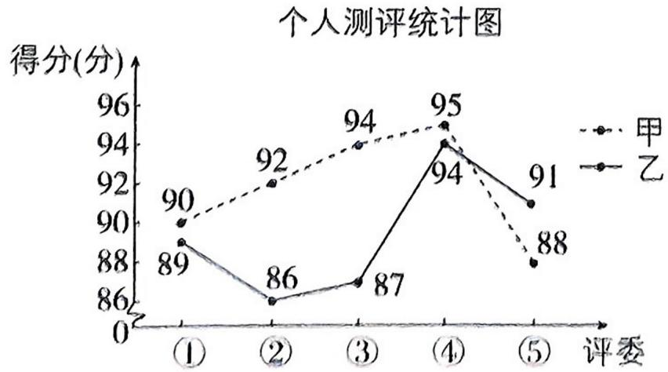
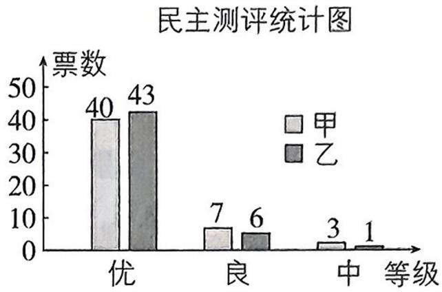

<!-- question-source:start -->
4[2024 江苏徐州鼓楼区调研]某班为了从甲、乙两人中选出一人担任班长,进行了一次测评活动,邀请了五位老师作为评委,对甲、乙进行个人测评,全班除甲、乙之外的50位同学对甲、乙进行民主测评,结果如下:

根据以上信息,解决下列问题:
(1)如果只采用个人测评,获胜者是\_\_\_\_
(填“甲”或“乙”); (算法:去掉一个最高分和一个最低分后,再算出平均分)
(2)甲的民主测评得分为\_\_\_\_,乙的民主测评得分为\_\_\_\_; (算法:“优”票数×3+“良”票数×2+“中”票数×1)
(3)在(1)(2)的条件下,若综合得分高的学生当选为班长,通过计算,判断最终当选的是甲还是乙. (算法:综合得分=个人测评得分×0.4+民主测评得分×0.6)
<!-- question-source:end -->

![[Q00106185A1]]
