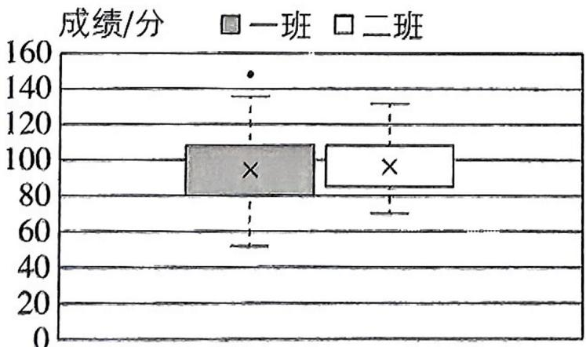

<!-- question-source:start -->
3 新素材 [2025 安徽芜湖质检]第九届亚洲冬季运动会于 2025 年 2 月 7 日至 2 月 14 日在黑龙江哈尔滨举行. 某校举办了一次“冬季运动会”知识竞赛, 已知一班和二班人数相等, 此次竞赛中两班成绩的箱线图如图所示 (注: 箱体中部的 “×” 表示平均值, “•” 为异常值, 即明显偏离样本的个别值), 则下列说法正确的是 ( )

A. 一班成绩比二班成绩集中
B. 一班成绩的上四分位数是80分
C. 一班有同学的成绩超过140分
D. 一班的平均分高于二班的平均分
<!-- question-source:end -->

![[Q00106221A1]]
