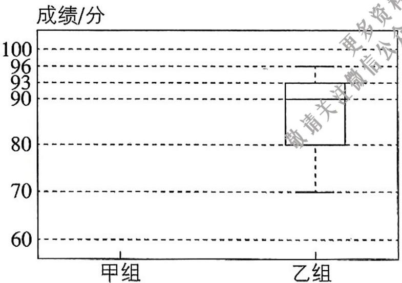

<!-- question-source:start -->
5[2025 广东深圳调研]甲、乙两组的测试成绩 (单位:分)如下:
甲:91,96,70,89,60,70,100,80,92,98;
乙:92,93,70,88,82,75,96,80,92,95.

(1)求甲组成绩的四分位数.

(2)根据四分位数可绘制如下的箱线图,观察图中乙组的箱线图,绘制甲组的箱线图.

(3)根据箱线图和对四分位数的理解,谈谈对两组成绩的看法.
<!-- question-source:end -->

![[Q00106223A1]]
