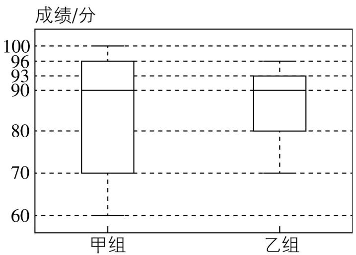

> [!success]- 必刷题
>
> > [!success] **【答案】** 详见解析
>
> > [!note]- **【解析】**
> > 【解】(1)把甲组的成绩从小到大排列为60, 70, 70, 80, 89, 91, 92, 96, 98, 100, 故中位数为 $\frac{89 + 91}{2} = 90$ (分), 下四分位数为70分, 上四分位数为96分.
> >
> > (2)甲组的箱线图如图所示.
> >
> > 
> >
> > (3)根据箱线图和四分位数,可知甲组成绩比较分散,乙组成绩比较集中(答案不唯一,合理即可).
