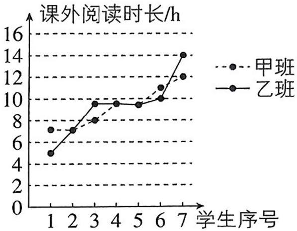

<!-- question-source:start -->
8[2025 河南许昌质检]某校为了解七年级甲、乙两班学生的课外阅读情况,从这两个班级中各随机抽取7名学生调查他们一周的课外阅读时长(单位:h),根据调查情况绘制了如图所示的折线统计图.设甲、乙两班抽取学生的一周课外阅读时长的方差分别为 $s_{\text {甲}}^{2},s_{\text {乙}}^{2}$ ,则 $s_{\text {甲}}^{2}$ \_\_\_\_ $s_{\text {乙}}^{2}$ . (填“>”“=”或“<”)

<!-- question-source:end -->

![[Q00106194A1]]
