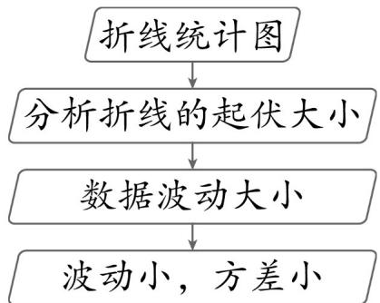

> [!success]- 必刷题
>
> > [!success] **【答案】** B
>
> > [!note]- **【解析】**
> > 因为 A、B 两名射击运动员进行了相同次数的射击, 所以当 A 成绩的平均数大于 B, 且方差比 B 小时, 能说明 A 成绩较好且更稳定.
> >
> > ## 8. < 【解析】
> >
> > 
> >
> > 由题图可得,甲班数据在7至12之间波动,波动范围较小,乙班数据在5至14之间波动,波动范围较大,所以 $s_{甲}^{2}<s_{乙}^{2}$ .故答案为<.
