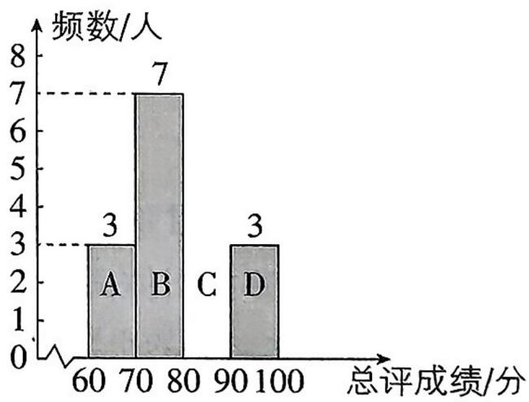

<!-- question-source:start -->
2[2025 山东淄博期中]某中学广播站计划招一批广播员,有 19 名学生报名参加选拔. 报名的学生需进行普通话、情境表达、个人才艺三项测试,每项测试均由五位评委打分(满分 100 分),取平均数作为该项的测试成绩,再按普通话占 50%,情境表达占 30%,个人才艺占 20% 计算出每人的总评成绩. 根据以下图表解答相关问题.

表 1:1 号和 2 号选手的三项测试成绩和总评成绩统计表：

<table><tr><td rowspan="2">选手</td><td colspan="3">测试成绩/分</td><td rowspan="2">总评成绩/分</td></tr><tr><td>普通话</td><td>情境表达</td><td>个人才艺</td></tr><tr><td>1号</td><td>80</td><td>75</td><td>85</td><td>79.5</td></tr><tr><td>2号</td><td>86</td><td>80</td><td>★</td><td>★</td></tr></table>

表2:1号和2号选手的个人才艺测试评委评分、平均数和方差统计表：

<table><tr><td>选手</td><td>评委评分/分</td><td>平均数/分</td><td>方差</td></tr><tr><td>1号</td><td>85,80,83,90,87</td><td>85</td><td> $s_1^2$ </td></tr><tr><td>2号</td><td>85,84,84.5,84,87.5</td><td>★</td><td> $s_2^2$ </td></tr></table>

(1) 利用表 2 数据作答:

①2 号选手的评委评分的众数是\_\_\_\_分，平均数是\_\_\_\_分.

②求 $s_1^2$ 和 $s_2^2$ 的值, 并比较大小.

(2) 计算 2 号选手的总评成绩.

(3)如图是这19名学生总评成绩的频数直方图 (不完整),学校决定根据总评成绩 $x$ 择优选拔 9 名广播员. (A: $60 \leqslant x < 70$ ; B: $70 \leqslant x < 80$ ; C: $80 \leqslant x < 90$ ; D: $90 \leqslant x \leqslant 100$ )

①补充完整总评成绩频数直方图.

②试分析1号、2号选手是否入选,并说明理由.

<!-- question-source:end -->

![[Q00106205A1]]
