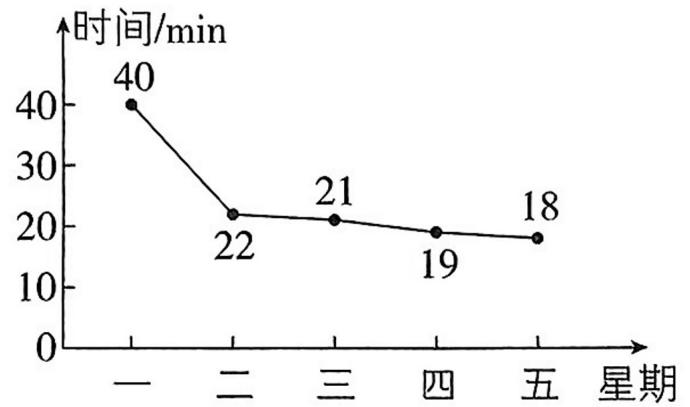
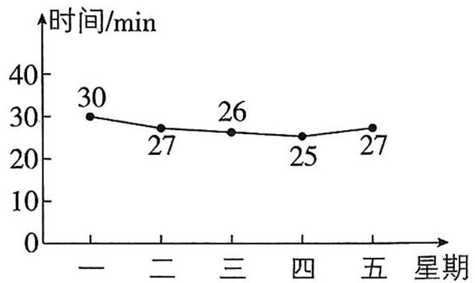

<!-- question-source:start -->
1. [2025 江苏南京期末]周老师平时上班有 A, B 两条路线可以选择, 她记录了两周共十天的上班路上所用的时间并绘制了如下统计图:

第一周上班选择路线A所用时间折线统计图

第二周上班选择路线B所用时间折线统计图

(1)这十天中周老师上班路上所用时间最多相差\_\_\_\_min.

(2)哪一条上班路线所用的时间更稳定？请通过计算说明.

(3)你建议周老师应如何选择上班路线?
<!-- question-source:end -->

![[Q00106404A1]]
